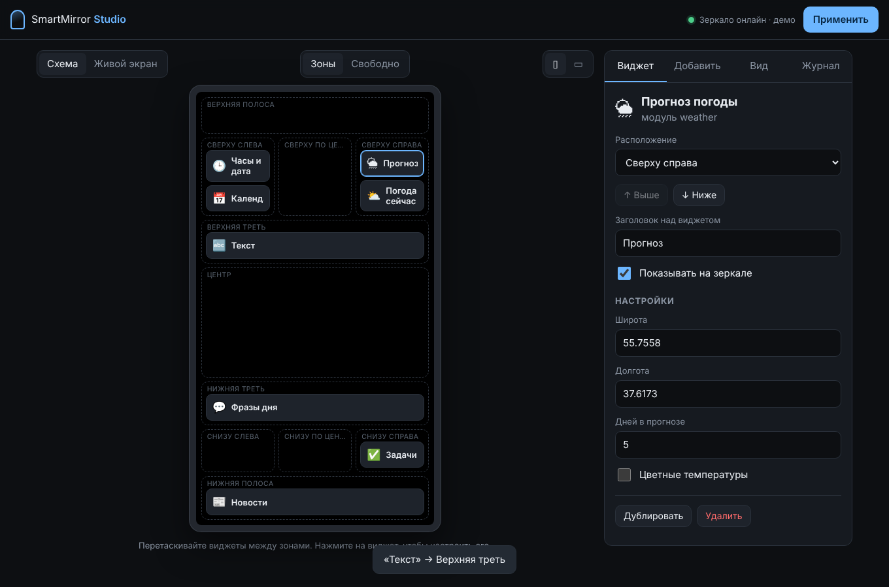

# SmartMirror

Умное зеркало на Raspberry Pi 4 + MagicMirror². В этом репозитории — **SmartMirror Studio**:
приложение, в котором пользователь добавляет виджеты, меняет их расположение и внешний вид,
а зеркало применяет изменения.

Raspberry Pi для разработки не нужен: зеркало запускается «виртуально» — MagicMirror² в
серверном режиме, экран открывается в браузере, а погода, календарь и новости в демо-режиме
берутся из встроенных тестовых источников.



## Как устроено

```
 Телефон / браузер                Raspberry Pi (или любой компьютер)
┌──────────────────┐   HTTP    ┌──────────────────────────────────────────────┐
│ Studio (веб-app) │ ────────► │ studio/server.js  :8090                       │
│ схема зеркала,   │  /api/*   │  ├─ data/layout.json   макет (черновик+прим.) │
│ drag & drop,     │           │  ├─ генерирует MagicMirror/config/config.js   │
│ настройки        │ ◄──────── │  │             и config/custom.css            │
│ «живой экран»    │  iframe   │  └─ перезапускает MagicMirror² ──► :8080       │
└──────────────────┘           │     (экран за зеркалом или вкладка браузера)  │
                               └──────────────────────────────────────────────┘
```

* **Макет** — размер экрана, способ раскладки, список виджетов
  `{type, position, header, enabled, options, free}` и настройки вида.
  Порядок в списке = порядок внутри зоны.
* **Каталог** (`studio/lib/catalog.js`) описывает каждый виджет: какие поля видит пользователь и
  как из них собрать конфиг модуля MagicMirror². Новый модуль = одна запись в каталоге.
* **Studio-сервер** проверяет всё, что пришло из приложения (тип, позиция, значения полей),
  поэтому мобильное приложение не может «сломать» config.js.
* **Применить** = записать config.js (старый сохраняется в `config.js.bak`) → перезапустить
  MagicMirror² → экран зеркала перезагружается сам.
* Без зависимостей: только Node.js ≥ 22, ничего ставить через npm для Studio не нужно.

Виджеты сейчас: часы, погода сейчас, прогноз, календарь (iCal), задачи (свой модуль
`modules/MMM-SimpleTodo`), курсы валют ЦБ РФ (свой модуль `modules/MMM-CBRRates`), новости (RSS),
фразы дня, произвольный текст.

**Сторонние модули** ставятся из Studio с GitHub при первом добавлении (`git clone` в
`MagicMirror/modules` + `npm install`, если у модуля есть зависимости):

| Виджет | Модуль | Что нужно |
|---|---|---|
| Акции и криптовалюты | [MMM-Jast](https://github.com/jalibu/MMM-Jast) | ничего, данные Yahoo Finance |
| Время в пути (пробки) | [MMM-Traffic](https://github.com/samlewis0602/MMM-Traffic) | бесплатный токен Mapbox |
| YouTube / трансляция | [MMM-EmbedYoutube](https://github.com/nitpum/MMM-EmbedYoutube) | доступ к YouTube |
| МКС онлайн | [MMM-ISS-Live](https://github.com/KristjanESPERANTO/MMM-ISS-Live) | доступ к YouTube |
| Свой модуль по ссылке | любой из [списка модулей](https://github.com/MagicMirrorOrg/MagicMirror/wiki/3rd-party-modules) | ссылка на GitHub и config в JSON |

Пока модуль не установлен, Studio не добавляет его в config.js, чтобы зеркало не ломалось.
Сторонний модуль — чужой код, который выполняется на зеркале; ставьте только те, которым доверяете.
Зоны — все стандартные позиции MagicMirror² от «Верхней полосы» до «Нижней полосы».

### Размер экрана и свободная раскладка

* **Экран** (вкладка «Вид»): диагональ и соотношение сторон или ширина и высота, в дюймах
  или сантиметрах, вертикально или горизонтально. Схема и живой экран принимают те же
  пропорции, а координаты виджетов в панели показываются в выбранных единицах.
* **Зоны / Свободно** (переключатель над схемой). В режиме «Свободно» виджет ставится в любую
  точку: его тащат по экрану, правый край меняет ширину, стрелки на клавиатуре сдвигают на
  5 мм (с Shift на 1 см). Место хранится в долях экрана (`free: {x, y, w, align}`), поэтому
  раскладка переживает смену монитора.
* Как это попадает на зеркало: все модули ставятся в одну зону, у каждого класс `sm-<id>`,
  а `custom.css` задаёт ему `position: fixed`, отступ слева и сверху и ширину в процентах.
* Высоту виджета задаёт его содержимое. Служебный модуль `modules/MMM-StudioBridge` сообщает
  приложению настоящие места и размеры виджетов с живого экрана, поэтому при переходе
  в «Свободно» всё остаётся на своих местах, а высота на схеме точная. На настоящем зеркале
  (вне Studio) этот модуль ничего не делает.

## Запуск без Raspberry Pi

**Windows.** Нужны [Node.js 24 LTS](https://nodejs.org) и [Git](https://git-scm.com).
Распакуйте архив, например, в `C:\Users\<имя>\smartmirror`, затем в cmd:

```bat
cd %USERPROFILE%\smartmirror
scripts\setup.cmd
scripts\start-demo.cmd
```

**Linux / macOS / Raspberry Pi:**

```bash
./scripts/setup.sh                 # ставит MagicMirror² в ../MagicMirror
cd studio && npm run demo          # --demo: погода/календарь/новости — тестовые
```

* Studio: http://localhost:8090
* Экран зеркала: http://localhost:8080

Без `--demo` (`npm start`) модули ходят за реальными данными в интернет.

Переменные окружения: `MM_DIR` (путь к MagicMirror², по умолчанию `../MagicMirror`),
`STUDIO_PORT` (8090), `MM_PORT` (8080), `MM_START_CMD` (`node serveronly`; на Pi с экраном —
`npm start`), `MM_IP_WHITELIST`.

## Проверки

```bash
cd studio && npm test                                   # проверка макета и генерации config.js
NODE_PATH=$(npm root -g) node scripts/e2e.js            # браузер: перетащить, добавить, применить
NODE_PATH=$(npm root -g) node scripts/e2e-modules.js    # курсы ЦБ, установка модулей с GitHub
NODE_PATH=$(npm root -g) node scripts/e2e-free.js       # размер экрана, свободная раскладка
NODE_PATH=$(npm root -g) node scripts/screenshot.js     # снимки в shots/
```

Скрипты с браузером используют Playwright и требуют запущенной Studio.

## API Studio (для будущего мобильного приложения)

| Метод | Путь | Что делает |
|---|---|---|
| GET | `/api/catalog` | виджеты, их поля, зоны, настройки вида и экрана |
| GET | `/api/layout` | макет, `revision`, `appliedRevision` |
| PUT | `/api/layout` | сохранить черновик `{baseRevision, layout}`; 409, если его уже изменили с другого устройства |
| POST | `/api/apply` | применить черновик к зеркалу |
| POST | `/api/reset` | стандартный набор виджетов |
| GET | `/api/modules` | сторонние модули из макета, которые ещё не установлены |
| POST | `/api/modules/install` | установить модуль `{repo: "https://github.com/автор/MMM-…"}` |
| GET | `/api/mirror`, `/api/mirror/logs`, `/api/mirror/diagnose` | состояние, журнал и диагностика MagicMirror² |

## Дальше

1. **Raspberry Pi.** `setup.sh` с `WITH_ELECTRON=1`, `MM_START_CMD="npm start"`, автозапуск через
   systemd или pm2, `STUDIO_HOST=0.0.0.0` и доступ с телефона по локальной сети.
2. **Безопасность.** Сейчас у Studio нет входа. Перед открытием в локальную сеть — код
   сопряжения (PIN на экране зеркала) и токен для приложения.
3. **Датчик движения** (PIR на GPIO) — модуль, который гасит/включает экран; появится в каталоге
   как ещё один виджет-«сервис» без позиции.
4. **Мобильное приложение** — обернуть текущий веб-клиент в Capacitor; поиск зеркала в сети через mDNS.
5. **Сторонние модули** — расширять каталог: календарь Яндекса/Google через CalDAV, трафик через другие сервисы, радио.
